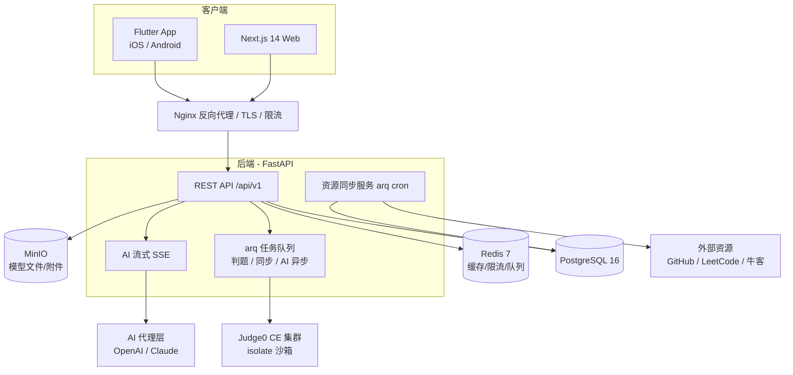
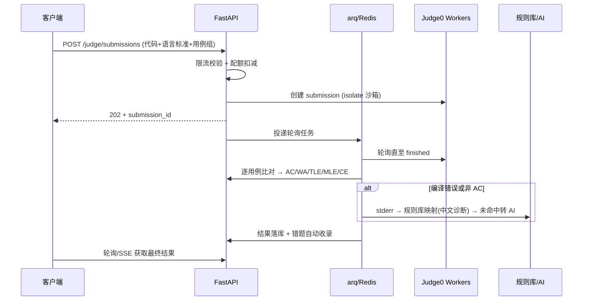
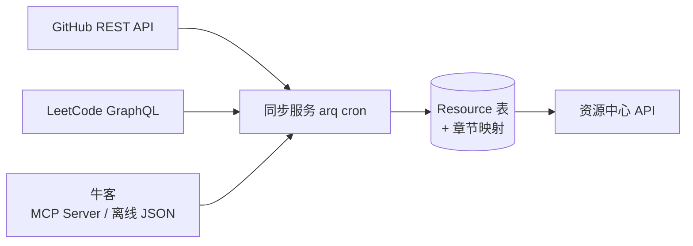

# CppMind · 阶段 2：技术架构

> 版本：v0.1（待确认） · 日期：2026-09-19 · 依据：Phase1-PRD v0.2
> 状态：**等待主人确认后进入阶段 3（数据库与 API）**

---

## 1. 架构总览



**架构决策记录（ADR 摘要）：**

| # | 决策 | 结论 | 关键理由 |
|---|---|---|---|
| ADR-1 | 移动端 | **Flutter 3 + Dart** | PRD 决策记录 1；单代码库双端；CustomPaint 画导图自由度高；lottie 生态成熟 |
| ADR-2 | Web 端 | **Next.js 14 + React + TypeScript** | App Router + SSR；Monaco/React Flow 生态；与移动端共享 API |
| ADR-3 | 后端 | **FastAPI（Python）** | 资源同步脚本天然 Python；AI 生态（openai/anthropic SDK）最全；Pydantic v2 强类型 |
| ADR-4 | 编译沙箱 | **Judge0 CE 自托管** | 60+ 语言、isolate 沙箱成熟、多文件支持、REST 接口；避免从零造沙箱的安全债 |
| ADR-5 | 数据库 | **PostgreSQL 16 + Redis 7** | PG 全文检索 + JSONB 够题库用；Redis 承担缓存/限流/队列三职 |
| ADR-6 | AI | **后端代理 + 双 provider** | Key 不出后端；OpenAI 默认、Claude 备用；SSE 流式 |
| ADR-7 | 部署 | **Docker Compose 起步** | 一键 `docker compose up`；后续可平滑迁 K8s |
| ADR-8 | Monorepo | **pnpm + Melos 混合仓** | app/ web/ server/ shared/ 四包，文档与脚本同仓 |

---

## 2. Monorepo 目录结构

```
CppMind/
├── app/                    # Flutter 移动端（iOS/Android）
├── web/                    # Next.js 14 Web
├── server/                 # FastAPI 后端
│   ├── app/
│   │   ├── api/v1/         # 路由层
│   │   ├── core/           # 配置/安全/限流/日志
│   │   ├── modules/        # auth, content, exercise, judge,
│   │   │                   # project, ai, resource, progress, clang, dl
│   │   ├── models/         # SQLAlchemy 2.0
│   │   ├── schemas/        # Pydantic v2
│   │   └── workers/        # arq 任务（判题回调、资源同步、AI 异步）
│   ├── scripts/            # 资源同步脚本、数据导入、内容校验
│   ├── alembic/            # 迁移
│   └── tests/
├── shared/
│   ├── tokens/             # Design Tokens 单一来源（→ 三端生成）
│   └── schemas/            # 题库 JSON schema、章节映射配置
├── deploy/
│   ├── docker-compose.yml  # 一键启动
│   ├── nginx/              # 反代配置
│   └── monitoring/         # Prometheus/Grafana 配置
├── content/                # 20 章学习内容源文件（Markdown + JSON）
└── docs/                   # PRD、架构、API、设计规范
```

---

## 3. 移动端架构（Flutter 3）

### 3.1 分层与状态管理

```
presentation（页面/Widget） → application（Riverpod providers/用例） → domain（实体/仓库接口） → data（DTO/远程API/本地缓存）
```

- **状态管理：Riverpod 2**（编译期安全、可测试；弃用 Provider/Bloc 的样板代码）。
- **路由：go_router**（声明式、深链友好——资源中心跳转、分享代码短链都需要深链）。
- **网络：dio + retrofit**，拦截器统一注入 JWT、处理刷新与错误码。
- **本地缓存：Drift（SQLite）**——章节内容、导图结构、错题本离线可读；学习进度离线暂存、联网回同步（乐观更新 + 冲突以服务端为准）。
- **主题：ThemeData 由 shared/tokens 生成**，亮/暗双主题 + "减少动效"开关写入 MediaQuery。

### 3.2 关键组件选型

| 组件 | 选型 | 备选 | 理由 |
|---|---|---|---|
| 代码编辑器 | **flutter_code_editor**（CodeField 系） | codemirror_flutter | 纯 Dart 渲染、无 WebView 性能坑；支持 C/C++ 高亮与自定义蓝白配色 |
| 思维导图 | **自定义 CustomPaint** | graphview | 四态节点色、猫咪提示浮层、500 节点 60fps 需自绘；数据驱动 MindMapNode 树 |
| 猫咪动效 | **lottie** 包 | rive | 设计交付为 Lottie JSON；SVG 静态表情用 flutter_svg |
| Markdown 渲染 | flutter_markdown + 自定义代码块 | — | 代码块注入"去运行"按钮 |
| 本地通知 | flutter_local_notifications | — | 每日任务/错题复习提醒 |

### 3.3 离线策略

- 可离线：章节内容、导图、错题本、已缓存代码示例。
- 不可离线（明确提示）：编译判题、AI 对话、资源同步。
- 缓存上限 200MB，LRU 清理。

---

## 4. Web 端架构（Next.js 14）

- **App Router + TypeScript strict**；RSC 渲染章节内容（SEO + 首屏快），交互区（编辑器/导图/AI 对话）为 Client Component。
- **样式：Tailwind CSS**，`tailwind.config` 由 shared/tokens 生成；同步产出 CSS 变量供非 Tailwind 场景。
- **编辑器：Monaco Editor**（与 VS Code 同源，C/C++ 体验天花板）。
- **思维导图：React Flow**（交互导图）+ Markmap（章节内快速预览）双轨。
- **数据层：TanStack Query**（缓存/重试/乐观更新）+ Zustand（编辑器本地状态）。
- **猫咪：lottie-web**，与移动端共用同一份 Lottie JSON 资源包。
- **暗色模式：class 策略**，跟随系统 + 手动覆盖，与移动端 token 一致。

---

## 5. 后端架构（FastAPI）

### 5.1 模块划分

| 模块 | 职责 |
|---|---|
| `auth` | 注册/登录/JWT（access 2h + refresh 30d）/第三方登录 |
| `content` | 章节/知识点/导图节点/代码示例/C 语言模块/DL 模块 |
| `exercise` | 题库 CRUD、筛选、错题本、收藏 |
| `judge` | 编译运行、判题、提交历史、编译错误规则库 |
| `project` | 项目七件套、任务打卡、模板打包 |
| `ai` | AI 代理、prompt 模板、上下文注入、对话存储、限额 |
| `resource` | GitHub/LeetCode/牛客资源引用、同步状态 |
| `progress` | 进度、掌握度、每日任务、学习计划、成就 |
| `admin` | 内容管理、手动触发同步、用户管理 |

### 5.2 关键中间件与横切

- **限流**：Redis 令牌桶，按用户 + IP 双维度；编译接口单独配额（免费层 10 次/日，Pro 100 次/日）。
- **统一响应**：`{ code, message, data, traceId }`；错误码段：1xxx 通用 / 2xxx 业务 / 3xxx 判题 / 4xxx AI。
- **异步任务：arq**（Redis 驱动，比 Celery 轻）——判题轮询回调、资源同步、AI 代码审查。
- **日志**：structlog JSON 日志 → Loki；请求级 traceId 贯穿到 arq 任务。
- **验证**：Pydantic v2 schemas 与 SQLAlchemy 模型分离；`response_model` 强约束。

### 5.3 认证流

```
登录 → 签发 access(2h) + refresh(30d, Redis 存白名单可吊销)
请求 → Authorization: Bearer <access>
401 → 客户端用 refresh 换新 access（旋转刷新，旧 refresh 立即失效）
```

---

## 6. 数据库与缓存

- **PostgreSQL 16**：26 个实体（User → Resource，见 PRD 第 11 节），阶段 3 输出完整表结构与 ER 图。题库/内容用 JSONB 存富文本与标签数组，`pg_trgm` + FTS 支撑全局搜索。
- **Redis 7**：①缓存（章节内容、资源清单，TTL 1h）②限流令牌桶 ③arq 队列 ④refresh token 白名单 ⑤判题结果暂存。
- **MinIO**：项目模板 tar 包、DL 模型文件（ONNX 等，用户自行下载官方权重时存指引而非权重）、Lottie/图片资源。
- **迁移：Alembic**，CI 强制 `alembic check` 防漂移。

---

## 7. 编译沙箱架构（Judge0 CE）

### 7.1 判题链路



### 7.2 安全参数（每提交强制）

| 限制项 | 值 |
|---|---|
| 网络 | **完全禁用**（isolate 默认无网） |
| 文件系统 | 只读根 + tmpfs 工作目录（≤32MB） |
| CPU 时间 | 5s（编程题）/ 2s（示例运行） |
| 墙钟超时 | 15s，超时 kill |
| 内存 | 256MB |
| 进程数 | 64 |
| 输出 | 1MB 截断 |
| 并发 | 每用户同时在跑 ≤2 |

支持标准：`gcc 11/12`（C11/C17）、`g++ 11/12/13`（C++11/14/17/20/23）。多文件/Makefile 项目：tar 包经 Judge0 `additional_files` 展开后按 entrypoint 构建。

### 7.3 扩容与兜底

- Judge0 server + N workers 独立容器，按队列深度水平扩 worker（MVP：server×1 + worker×2）。
- 队列深度 > 50 时前端提示"编译高峰期，预计等待 X 秒"，不丢请求。
- **自建备选**（不实施，仅备案）：Docker + nsjail + seccomp，g++/clang 镜像，仅在 Judge0 成为瓶颈或需要 GPU 时启用。

---

## 8. AI 架构

### 8.1 代理层

```
客户端 → /api/v1/ai/chat (SSE 流式)
        → Provider 抽象层
            ├── OpenAIProvider（默认）
            └── ClaudeProvider（备用，env 切换/降级）
```

- Key 仅存服务端 `.env` / secrets，**绝不进客户端、不进日志**。
- 流式：SSE `data:` 事件逐 token 推送；断线可凭 conversation_id 续拉。
- 模型分级：编译诊断/短答 → 小模型（gpt-4o-mini 级）；模拟面试/代码审查 → 大模型。

### 8.2 上下文注入流水线

```
当前章节(目标+知识点摘要) + 当前代码(≤4KB) + 最近错题(≤3) + 用户进度(方向/已完成%)
    → token 预算裁剪(总计 ≤6K)
    → 模式 prompt 模板拼接
    → Provider
```

### 8.3 五大模式（prompt 模板存 DB，可热更新）

| 模式 | 行为约束 | 猫咪联动 |
|---|---|---|
| 苏格拉底教学 | 只提问引导，禁止直接给完整答案 | 思考/疑惑 |
| 编译错误诊断 | 规则库先行（gcc 常见错误正则→中文解释+修复建议），未命中转 AI | 疑惑+安慰 |
| 代码审查 | 风格/内存/并发/UB 四维度清单式输出 | 点头 |
| 面试模拟（P2） | 扮演面试官，追问链，结束出评分报告 | 加油 |
| 学习计划/DL 指导 | 注入方向+进度+可投入时间；DL 模式注入官方文档摘要 | 庆祝 |

### 8.4 成本控制

免费层：20 轮对话/日 + 诊断不限（规则库优先）；响应缓存（相同 stderr 指纹命中缓存）；prompt 长度硬上限；月度预算告警。

---

## 9. 资源整合架构

### 9.1 数据流



### 9.2 三源接入方案

**GitHub**（MVP 实装）
- REST API + 服务端 token；按 `shared/schemas/github_repos.yaml` 中的"章节→仓库清单"同步 star/描述/最近更新。
- 清单初值：awesome-modern-cpp、CPlusPlus-Programming-Language-Foundation、labex cpp-practice-projects、tinytetris、线程池/JSON 解析器/迷你 STL/HTTP 服务器/聊天室等经典项目（阶段 7 定稿全量清单）。
- 频率：每日 03:00 全量 + 手动 `POST /admin/sync/github`。

**LeetCode**（MVP 实装）
- GraphQL `questionData` 仅拉**元数据**（题号/标题/难度/标签/链接），**不存题面正文**，点击跳原站——规避版权风险。
- 章节映射配置（JSON，示例）：基础语法→入门题单；数据结构→数据结构专题；算法→算法专题；面试→热题 100。

**牛客**（MVP 用方案 B，P1 试方案 A）
- 方案 B：离线题库 JSON（面试 TOP101 的章节映射 + 链接，格式见阶段 3 题库 schema），随版本发布更新。
- 方案 A：`nowcoder-mcp-server` 接 MCP 获取题目/题解/面经——P1 做技术验证，通过则替换 B。

**其他引用**（纯深链，无同步）：cppreference（概念页"延伸阅读"）、Compiler Explorer（示例"在 Godbolt 中打开"）、LearnCpp、PyTorch/ONNX Runtime/TensorRT 官方文档（DL 模块引用）。

### 9.3 合规红线

只存元数据与链接，不整站搬运任何第三方题面/文章正文；每条 Resource 记录 `source + license + url`；GitHub 侧遵守 API 速率与 ToS。

---

## 10. 部署架构

### 10.1 Docker Compose 服务清单

| 服务 | 镜像 | 说明 |
|---|---|---|
| `nginx` | nginx:alpine | TLS、反代、静态资源、限流第一层 |
| `api` | 自建（python:3.12-slim） | FastAPI + uvicorn ×2 |
| `worker` | 同 api 镜像 | arq 任务消费者 |
| `web` | 自建（node:22） | Next.js standalone |
| `postgres` | postgres:16 | 数据卷持久化 |
| `redis` | redis:7 | 持久化 AOF |
| `judge0-server` | judge0/judge0:1.13 CE | 判题 API |
| `judge0-workers` | judge0/judge0:1.13 CE | ×2，privileged + isolate |
| `minio` | minio/minio | 对象存储 |
| `prometheus` + `grafana` | 官方镜像 | 监控面板 |
| `loki` + `promtail` | 官方镜像 | 日志 |

错误追踪用 **Sentry SaaS**（不自建，省运维）。`docker compose up -d` 一键起全栈；`make dev` 起开发热更新环境。

### 10.2 CI/CD（GitHub Actions）

```
PR → lint(ruff/eslint/dart analyze) + 单测 + alembic check + 内容完整性校验(20章×7类)
main → 构建镜像 → 推送 registry → staging 自动部署 → 冒烟测试 → 手动批准 → prod
```

### 10.3 监控指标

API P95 延迟、判题队列深度、沙箱失败率、AI 调用成本/日、同步任务成功率、PostgreSQL 慢查询。Grafana 预置 4 块面板：系统 / 判题 / AI / 业务（学习闭环漏斗）。

---

## 11. 安全设计清单

- 沙箱：第 7.2 节全部限制 + 每用户并发与速率双重闸。
- API：全接口鉴权（除资源/章节公开只读）、参数化查询、CORS 白名单、请求体 ≤2MB。
- 密钥：JWT 密钥、AI Key、GitHub token 全部走环境变量/secrets；仓库内置 `.env.example` 不含真值。
- 上传：项目模板 tar 解压前白名单校验（禁绝对路径/`..`/符号链接）。
- 前端：XSS（Markdown 渲染消毒）、CSRF（Bearer 方案天然免疫 + SameSite cookie 双保险）。

---

## 12. 性能预算与容量估算

| 指标 | 目标 | 手段 |
|---|---|---|
| 导图 500 节点 | ≥50fps | CustomPaint 视口裁剪 + 节点缓存 |
| API P95 | <300ms | Redis 缓存热点、N+1 消除、连接池 |
| 判题 P95 | <15s | worker 水平扩、队列削峰 |
| 移动端首屏 | <2s | 骨架屏 + 章节预取 |
| 规模假设 | MVP 期 DAU 1k，峰值并发编译 20/s | 当前配置可承载 5 倍冗余 |

---

## 13. 架构风险与对策

| 风险 | 对策 |
|---|---|
| Judge0 单点 | worker 多副本；server 故障时判题请求排队 + 用户提示，不影响学习主流程 |
| AI provider 故障/超预算 | 双 provider 自动降级；超预算时切换"规则库 + 缓存"纯本地诊断模式 |
| Flutter 编辑器体验不及原生 | 已选纯 Dart 方案规避 WebView 坑；P1 预留键盘工具条迭代位 |
| 牛客 MCP Server 不可用 | MVP 不依赖（方案 B 离线 JSON），P1 验证失败则长期保持 B |
| 20 章内容生产拖期 | 内容与代码解耦（content/ 目录独立版本化），内容缺失不阻塞工程里程碑 |

---

**—— 阶段 2 结束。请主人确认（可提出选型调整），确认后进入阶段 3：数据库与 API（完整表结构 + ER 图 + API 文档 + 资源同步 API）。**
