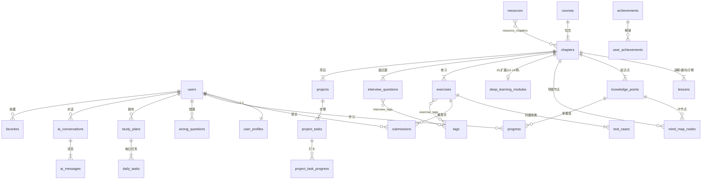

# CppMind · 阶段 3：数据库与 API

> 版本：v0.1（待确认） · 日期：2026-09-19 · 依据：Phase1-PRD v0.2、Phase2-Architecture v0.1
> 状态：**等待主人确认后进入阶段 4（后端代码）**

---

## 1. 设计约定

| 约定 | 规则 |
|---|---|
| 主键 | `BIGINT` 自增（内部关联）+ `uuid` 对外暴露（防枚举） |
| 时间戳 | 所有表含 `created_at` / `updated_at`（下文省略不写），UTC 存储 |
| 软删除 | 内容类表（chapter/lesson/exercise/project）用 `deleted_at`，用户数据硬删除 |
| 富文本 | 一律 Markdown 存 `TEXT`/`JSONB`，前端渲染时消毒 |
| 枚举 | 用 PG 原生 ENUM，变更走 Alembic 迁移 |
| 命名 | 蛇形复数表名；布尔字段 `is_/has_` 前缀 |
| 实体口径 | 主人清单 25 个概念实体 + 新增 `sync_jobs`（资源同步任务）= **26 个概念实体**；另有 7 张连接/辅助表单独列出，不计入概念实体 |

---

## 2. 实体分组总览

| 分组 | 概念实体 | 连接/辅助表 |
|---|---|---|
| 账户 | users, user_profiles | user_oauth_identities |
| 内容 | courses, chapters, lessons, knowledge_points, mind_map_nodes, deep_learning_modules | — |
| 题库 | exercises, test_cases, interview_questions, tags | exercise_tags, interview_question_tags |
| 判题 | submissions | — |
| 进度 | progress, notes, wrong_questions, study_plans, daily_tasks, achievements | user_achievements |
| 项目 | projects, project_tasks | project_task_progress |
| AI | ai_conversations, ai_messages | — |
| 资源 | resources, sync_jobs, favorites | resource_chapters |

---

## 3. 完整表结构

### 3.1 账户组

**users**
| 字段 | 类型 | 说明 |
|---|---|---|
| id / uuid | BIGINT / UUID | 内/外主键 |
| email | VARCHAR(255) UNIQUE | 邮箱登录 |
| phone | VARCHAR(20) UNIQUE NULL | 手机号登录，可空 |
| password_hash | VARCHAR(255) | bcrypt |
| role | ENUM(user, admin) | 默认 user |
| status | ENUM(active, banned) | 封禁支持 |
| last_login_at | TIMESTAMPTZ NULL | |

**user_profiles**（与 users 1:1）
| 字段 | 类型 | 说明 |
|---|---|---|
| user_id | BIGINT FK UNIQUE | |
| nickname / avatar_url | VARCHAR | |
| direction | ENUM(exam, job, dl) | 决定推荐路径（PRD 2 节三画像） |
| daily_minutes | INT | 每日可投入分钟，AI 生成计划用 |
| plan | ENUM(free, pro) | 配额分级（编译 10/100 次/日） |
| theme | ENUM(light, dark, system) | 蓝白双主题 |
| reduced_motion | BOOLEAN | 减少动效开关（可访问性） |
| font_scale | NUMERIC(3,2) | 字号可调 |

**user_oauth_identities**：`user_id FK, provider(wechat/qq/github), openid, UNIQUE(provider, openid)`

### 3.2 内容组

**courses**：`code UNIQUE(cpp/clang), title, description, sort` —— C++ 主线（20 章）与 C 语言模块（7 单元）各为一条 course；DL 内容挂在 C++ 主线的 12–14 章，由 `deep_learning_modules` 扩展。

**chapters**
| 字段 | 类型 | 说明 |
|---|---|---|
| course_id | BIGINT FK | |
| idx | INT | 0–19（C++）/ 0–6（C 单元） |
| code | VARCHAR(20) UNIQUE | 如 `cpp-ch03`、`clang-ch01`，外部映射用 |
| title / goals | VARCHAR / JSONB | goals = 学习目标数组（7 类内容之 1） |
| estimated_minutes | INT | 学习计划排程用 |
| is_free | BOOLEAN | 游客可浏览章节标记（PRD：游客 3 章） |
| deleted_at | TIMESTAMPTZ NULL | |

**lessons**（概念讲解 / 避坑 / 代码示例统一载体，7 类内容之 2/3/5）
| 字段 | 类型 | 说明 |
|---|---|---|
| chapter_id | BIGINT FK | |
| kp_id | BIGINT FK NULL | 可挂到知识点 |
| type | ENUM(concept, pitfall, example) | example = 可运行代码示例 |
| title / content_md | VARCHAR / TEXT | |
| code / code_lang / code_std | TEXT / ENUM(c,cpp) / ENUM(c11,c17,cpp11,cpp14,cpp17,cpp20,cpp23) | type=example 时必填 |
| stdin / expected_output | TEXT NULL | 示例自带演示输入与期望输出 |
| sort | INT | |

> 决策：代码示例**不设独立表**，以 `lessons.type=example` 承载（与 PRD 9 节"复用 Lesson 代码块"一致），避免两处维护同一段代码。

**knowledge_points**：`chapter_id FK, title, summary, difficulty SMALLINT(1-5), sort`

**mind_map_nodes**：`chapter_id FK NULL, kp_id FK NULL, parent_id 自引用 NULL, label, pos_x NUMERIC, pos_y NUMERIC, sort` —— 节点四态色**不落库**，由用户 progress 实时推导（见 9.2 自查 #3）。

**deep_learning_modules**：`chapter_id FK UNIQUE（仅 12–14 章）, type ENUM(math, ecosystem, path), framework ENUM(pytorch, onnx, tensorrt, libtorch, llama_cpp, triton) NULL, content_md, sort`

### 3.3 题库组

**exercises**
| 字段 | 类型 | 说明 |
|---|---|---|
| chapter_id | BIGINT FK | |
| type | ENUM(choice, fix_error, output, coding) | 四类题型 |
| difficulty | ENUM(easy, mid, hard) | 简单绿/中等黄/困难红 |
| title / content_md | VARCHAR / TEXT | |
| options | JSONB NULL | 选择题选项 |
| answer | JSONB | 各题型统一答案结构 |
| explanation | TEXT | 解析 |
| source | ENUM(self, leetcode, nowcoder) | 自建 or 外部映射 |
| external_id / external_url | VARCHAR NULL | 外部题只存元数据+链接（合规红线） |
| time_limit_ms / memory_limit_mb | INT | coding 题判题限制 |
| is_daily_eligible | BOOLEAN | 每日一题候选 |

**test_cases**：`exercise_id FK, input TEXT, expected_output TEXT, is_sample BOOLEAN, sort`（仅 coding 题；非示例用例对前端不可见）

**interview_questions**：`chapter_id FK, question TEXT, answer_md TEXT, follow_ups JSONB（面试官追问链）, difficulty, source, company_tags JSONB`

**tags**：`name UNIQUE, category(syntax/ds/algo/topic/company)` + **exercise_tags / interview_question_tags** 两张连接表。

### 3.4 判题组

**submissions**
| 字段 | 类型 | 说明 |
|---|---|---|
| user_id / exercise_id | BIGINT FK / FK NULL | **exercise_id 可空 = 自由运行台** |
| lang | ENUM(c11,c17,cpp11,cpp14,cpp17,cpp20,cpp23) | |
| source_code | TEXT | |
| stdin | TEXT NULL | 自由运行时用户输入 |
| status | ENUM(queued, running, ac, wa, tle, mle, ce, re, ie) | ie=系统内部错误 |
| stdout / stderr | TEXT | 截断至 64KB |
| time_ms / memory_kb | INT NULL | 性能对比示例的数据来源 |
| judge0_token | VARCHAR(64) | 判题回查 |
| diagnosis_md | TEXT NULL | 规则库/AI 中文诊断结果 |

索引：`(user_id, created_at DESC)`、`(exercise_id, status)`。

### 3.5 进度组

**progress**：`user_id FK, kp_id FK, mastery SMALLINT(0未学/1学过/2掌握/3精通), last_studied_at, UNIQUE(user_id, kp_id)` —— 导图节点色、章节完成度均由它聚合推导。

**notes**：`user_id FK, target_type ENUM(kp, exercise, project), target_id BIGINT, content_md` + 复合索引。

**wrong_questions**
| 字段 | 类型 | 说明 |
|---|---|---|
| user_id | BIGINT FK | |
| question_type | ENUM(exercise, interview) | 多态，避免两张错题表 |
| question_id | BIGINT | 与 type 联合校验 |
| wrong_count / right_count | INT | 重做统计 |
| next_review_at | TIMESTAMPTZ | **间隔复习调度字段**（自查 #2 新增） |
| last_result | ENUM(wrong, right) | |
| | | UNIQUE(user_id, question_type, question_id) |

**study_plans**：`user_id FK, direction, start_date, end_date, weekly_hours, generated_by ENUM(ai, manual), config JSONB, status ENUM(active, done, abandoned)`

**daily_tasks**：`plan_id FK, date DATE, target_type ENUM(kp, exercise, project_task), target_id, title, status ENUM(pending, done, skipped), done_at NULL` + `UNIQUE(plan_id, date, target_type, target_id)`

**achievements**：`code UNIQUE(first_ac, streak_7, project_done...), title, description, icon, condition JSONB` + **user_achievements**：`user_id, achievement_id, unlocked_at, UNIQUE(user_id, achievement_id)`

### 3.6 项目组

**projects**：`chapter_id FK, category ENUM(basic, system, dl), title, requirement_md, architecture_md, deploy_md, interview_md（七件套中的四件 md）, template_url（MinIO tar 包）, difficulty, sort`

**project_tasks**：`project_id FK, title, description, order_no, verification JSONB（步骤验收/测试说明）`

**project_task_progress**：`user_id, task_id, done_at, UNIQUE(user_id, task_id)`

### 3.7 AI 组

**ai_conversations**：`user_id FK, mode ENUM(socratic, diagnose, review, interview, plan, dl_guide), chapter_id FK NULL, title, context_snapshot JSONB（注入时的章节/代码/错题/进度快照，可复盘）`

**ai_messages**：`conversation_id FK, role ENUM(system, user, assistant), content TEXT, model VARCHAR(50), tokens_in INT, tokens_out INT` —— 成本核算与 SSE 断线续拉都靠它。

> AI 每日配额**不落库**：Redis 计数器 `ai:quota:{user_id}:{date}`，TTL 48h（自查 #5）。

### 3.8 资源组

**resources**
| 字段 | 类型 | 说明 |
|---|---|---|
| source | ENUM(github, leetcode, nowcoder, doc) | |
| type | ENUM(repo, problem, article, doc_link) | |
| external_id | VARCHAR(128) | 如 `leetcode:1`、`github:owner/repo` |
| title / title_cn / description | VARCHAR / TEXT | |
| url | VARCHAR(512) | 一律跳原站 |
| difficulty | ENUM(easy, mid, hard) NULL | 外部题目映射用 |
| stars / license | INT NULL / VARCHAR(50) NULL | GitHub 资源用 |
| extra | JSONB | 标签、面经公司等非标字段 |
| last_synced_at | TIMESTAMPTZ | |
| | | UNIQUE(source, external_id) |

**resource_chapters**：`resource_id, chapter_id, UNIQUE(resource_id, chapter_id)` —— 章节↔资源多对多（一道 LeetCode 题可映射多章）。

**sync_jobs**：`source, status ENUM(running, success, failed), mode ENUM(full, incremental), stats JSONB（新增/更新/失败数）, error TEXT NULL, started_at, finished_at`

**favorites**：`user_id FK, target_type ENUM(kp, exercise, lesson, resource, interview), target_id, UNIQUE(user_id, target_type, target_id)`

---

## 4. ER 图（核心关系）



---

## 5. API 设计规范

- 前缀：`/api/v1`，REST 风格，资源名复数。
- 认证：`Authorization: Bearer <access>`；标注 `[可选鉴权]` 的接口支持游客（仅前 3 个免费章节返回完整内容，其余返回 4021 引导登录）。
- 统一响应：

```json
{ "code": 0, "message": "ok", "data": { }, "traceId": "01J..." }
```

- 错误码段：`0` 成功；`1xxx` 通用（1001 参数错误、1002 未认证、1003 无权限、1004 不存在、1005 限流）；`2xxx` 业务（2001 配额耗尽、4021 游客受限）；`3xxx` 判题；`4xxx` AI（4001 provider 故障、4002 超预算降级）。
- 分页：`?page=1&size=20`（size ≤100），响应含 `total/page/size/items`。
- 限流响应：`429 + code:1005 + retry_after`。

---

## 6. API 清单（按模块）

### 6.1 auth / users
| 方法 | 路径 | 说明 | 鉴权 |
|---|---|---|---|
| POST | /auth/register | 邮箱/手机号注册 | 无 |
| POST | /auth/login | 登录，签发 access+refresh | 无 |
| POST | /auth/refresh | 旋转刷新 | refresh |
| POST | /auth/oauth/{provider} | 第三方登录 | 无 |
| GET / PATCH | /users/me | 资料读写（含 direction、reduced_motion） | 登录 |

### 6.2 content（章节/导图/知识点/C 模块/DL）
| 方法 | 路径 | 说明 | 鉴权 |
|---|---|---|---|
| GET | /courses | 课程列表（C++ / C 语言） | 可选 |
| GET | /chapters?course_id= | 章节列表（含个人完成度） | 可选 |
| GET | /chapters/{id} | 章节详情：goals + 7 类内容索引 | 可选 |
| GET | /chapters/{id}/lessons?type= | concept / pitfall / example 分区拉取 | 可选 |
| GET | /chapters/{id}/mindmap | 导图节点树（含推导出的四态） | 可选 |
| GET / PATCH | /knowledge-points/{id} (+/mastery) | 知识点详情 / 标记掌握度 | 登录 |
| GET | /dl/modules | DL 模块（math/ecosystem/path） | 可选 |
| GET | /search?q= | 全局搜索（知识点/题目/示例） | 登录 |

### 6.3 exercise / judge（题库与判题）
| 方法 | 路径 | 说明 | 鉴权 |
|---|---|---|---|
| GET | /exercises?chapter_id=&type=&difficulty=&tag=&source=&page= | 多维筛选 | 可选 |
| GET | /exercises/{id} | 题目详情（隐藏非示例用例） | 可选 |
| POST | /judge/submissions | 提交运行/判题（exercise_id 可空=自由运行） | 登录 |
| GET | /judge/submissions/{id} | 轮询结果（含 diagnosis_md） | 登录 |
| GET | /judge/submissions?exercise_id= | 提交历史 | 登录 |
| GET | /wrong-questions?mode=review | 错题本/复习队列（next_review_at 到期） | 登录 |
| POST | /wrong-questions/{id}/redo | 重做结果上报（更新调度） | 登录 |
| GET | /interview-questions?chapter_id= | 面试题（含追问链） | 可选 |
| GET | /exercises/daily | 每日一题 | 可选 |

### 6.4 progress / plan
| 方法 | 路径 | 说明 | 鉴权 |
|---|---|---|---|
| GET | /progress/dashboard | 仪表盘聚合（各章完成度/打卡/提交数） | 登录 |
| POST | /plans/generate | AI 生成学习计划 | 登录 |
| GET | /plans/current + /daily-tasks?date= | 当前计划与当日任务 | 登录 |
| POST | /daily-tasks/{id}/complete | 任务打卡 | 登录 |
| GET | /achievements/my | 我的成就 | 登录 |
| POST | /notes, GET /notes?target_type=&target_id= | 笔记 | 登录 |
| POST / DELETE | /favorites | 收藏/取消 | 登录 |

### 6.5 project
| 方法 | 路径 | 说明 | 鉴权 |
|---|---|---|---|
| GET | /projects?category=basic/system/dl | 项目列表 | 可选 |
| GET | /projects/{id} | 七件套详情 | 可选 |
| GET | /projects/{id}/template | 模板 tar 包下载（MinIO 预签名） | 登录 |
| POST | /project-tasks/{id}/complete | 步骤打卡 | 登录 |

### 6.6 ai
| 方法 | 路径 | 说明 | 鉴权 |
|---|---|---|---|
| POST | /ai/conversations | 建会话（mode + chapter_id + 注入上下文） | 登录 |
| POST | /ai/conversations/{id}/messages | 发消息，**SSE 流式返回** | 登录 |
| GET | /ai/conversations / {id} | 会话列表 / 历史（断线续拉） | 登录 |
| GET | /ai/quota | 剩余配额 | 登录 |

### 6.7 resources（资源中心，公开只读）
| 方法 | 路径 | 说明 | 鉴权 |
|---|---|---|---|
| GET | /resources?source=&type=&chapter_id=&page= | 资源清单（GitHub 仓库/LC 题/牛客映射） | 可选 |
| GET | /resources/leetcode-map | 章节→LC 题目映射表 | 可选 |

### 6.8 admin（管理，role=admin）
| 方法 | 路径 | 说明 |
|---|---|---|
| POST | /admin/sync | 手动触发同步 `{source, mode}` |
| GET | /admin/sync/jobs / {job_id} | 同步任务状态与历史 |
| POST | /admin/content/import | 题库 JSON 导入（schema 校验） |
| GET | /admin/content/coverage | 20 章 × 7 类内容完整性报告 |

---

## 7. 关键接口示例

### 7.1 提交判题 `POST /api/v1/judge/submissions`

请求：
```json
{
  "exercise_id": 1024,
  "lang": "cpp17",
  "source_code": "#include <iostream>\nint main(){std::cout<<\"hello\";}",
  "stdin": ""
}
```
202 响应：
```json
{ "code": 0, "data": { "submission_id": 88001, "status": "queued", "poll_after_ms": 800 }, "traceId": "01J9..." }
```
轮询 `GET /judge/submissions/88001` 终态：
```json
{
  "code": 0,
  "data": {
    "status": "wa",
    "passed": 3, "total": 5,
    "time_ms": 42, "memory_kb": 3580,
    "failed_case": { "is_sample": true, "input": "5\n1 2 3 4 5", "expected": "15", "actual": "0" },
    "diagnosis_md": "**规则库诊断**：累加变量 `sum` 未初始化……"
  }
}
```

### 7.2 AI 对话 `POST /api/v1/ai/conversations/{id}/messages`（SSE）

请求：
```json
{ "content": "为什么这段代码段错误？", "attach": { "submission_id": 88001 } }
```
响应流：
```
event: meta      data: {"message_id": 551, "model": "gpt-4o-mini", "mode": "socratic"}
event: delta     data: {"text": "别急着看答案——先想想：指针 p 指向的内存是什么时候释放的？"}
event: delta     data: {"text": "……"}
event: done      data: {"tokens_in": 812, "tokens_out": 156, "quota_left": 17}
```

### 7.3 章节导图 `GET /api/v1/chapters/3/mindmap`

```json
{
  "code": 0,
  "data": {
    "chapter_code": "cpp-ch03",
    "nodes": [
      { "id": 31, "parent_id": null, "label": "内存与对象模型", "x": 0, "y": 0, "state": "mastered" },
      { "id": 32, "parent_id": 31, "kp_id": 301, "label": "栈与堆", "x": -120, "y": 80, "state": "learning" },
      { "id": 33, "parent_id": 31, "kp_id": 302, "label": "对象布局", "x": 120, "y": 80, "state": "weak" }
    ]
  }
}
```
`state ∈ mastered/learning/unlearned/weak`，由 progress + 近期正确率推导。

---

## 8. 资源同步 API 设计

### 8.1 触发与查询

- `POST /admin/sync` 请求体：
```json
{ "source": "github", "mode": "incremental" }
```
响应 `{ "job_id": 77, "status": "running" }`，任务由 arq 执行；cron 每日 03:00 自动全量（架构文档 9.2）。
- `GET /admin/sync/jobs/{job_id}`：
```json
{ "status": "success", "stats": { "created": 12, "updated": 140, "failed": 0 }, "duration_s": 38 }
```

### 8.2 同步语义

| 源 | 拉取内容 | 写入 | 冲突策略 |
|---|---|---|---|
| github | repo 描述/star/更新时间与 topics | resources（type=repo）+ resource_chapters | 以 `UNIQUE(source, external_id)` upsert |
| leetcode | 题号/标题/难度/标签/链接（GraphQL，**无正文**） | resources（type=problem） | upsert；映射关系以 `shared/schemas/leetcode_map.json` 为准 |
| nowcoder | 离线 JSON 导入（MVP） | 同上 | 导入时整包校验 schema，失败整包回滚 |
| doc | 静态配置（cppreference 等深链） | 随迁移种子数据写入 | 不参与定时同步 |

### 8.3 容错

单条失败记入 `stats.failed` 与 `error` 摘要，不中断任务；连续 3 次任务失败 → Sentry 告警 + Grafana 同步面板标红。

---

## 9. 题库 JSON 格式定义

### 9.1 外部题目映射包（LeetCode/牛客导入用）

```json
{
  "meta": { "format": "cppmind-external-v1", "source": "leetcode", "generated_at": "2026-09-19T03:00:00Z" },
  "items": [
    {
      "external_id": "leetcode:1",
      "title": "Two Sum", "title_cn": "两数之和",
      "difficulty": "easy",
      "tags": ["array", "hash-table"],
      "url": "https://leetcode.cn/problems/two-sum/",
      "mapped_chapters": ["cpp-ch01", "cpp-ch08"]
    }
  ]
}
```

### 9.2 自建题库包（阶段 7 内容生产与 admin 导入用）

```json
{
  "meta": { "format": "cppmind-exercise-v1", "chapter": "cpp-ch03" },
  "items": [
    {
      "type": "coding", "difficulty": "mid",
      "title": "实现 unique_ptr 简化版",
      "content_md": "请实现 `UniquePtr<T>`，支持移动语义……",
      "answer": { "reference_code": "..." },
      "explanation": "考点：RAII 与移动语义……",
      "tags": ["smart-pointer", "raii"],
      "time_limit_ms": 2000, "memory_limit_mb": 256,
      "test_cases": [
        { "input": "", "expected_output": "ok", "is_sample": true }
      ]
    },
    {
      "type": "choice", "difficulty": "easy",
      "title": "关于栈对象析构",
      "content_md": "以下说法正确的是？",
      "options": [{ "key": "A", "text": "……" }],
      "answer": { "correct": ["B"] },
      "explanation": "……"
    }
  ]
}
```

校验规则：导入时逐字段 schema 校验（Pydantic）+ 业务校验（coding 题必须有 ≥1 个测试用例；choice 题 options ≥2 且 correct ⊆ options.key）→ 全部通过才落库，**整包事务，失败回滚**。

---

## 10. 逻辑漏洞自查（首次执行，覆盖阶段 1–3）

| # | 检查点 | 结论 | 处理 |
|---|---|---|---|
| 1 | 自由运行台没有题目，Submission 如何归属？ | 原设计漏了 | `submissions.exercise_id` 改为 **NULL 可空**，已写入 3.4 |
| 2 | 错题本"复习模式"靠什么调度？ | 原清单无复习字段，无法实现"间隔复习提醒" | `wrong_questions` 增加 `next_review_at / right_count`，已写入 3.5 |
| 3 | 导图节点四态若落库，会与 progress 双写不一致 | 风险确认 | 四态**不落库**，由 progress + 近期正确率实时推导（见 7.3 示例） |
| 4 | PRD 允许"游客浏览 3 章"，与"全接口鉴权"表述冲突 | 表述冲突 | API 规范增加 `[可选鉴权]` 机制 + `is_free` 字段 + 4021 错误码，已写入第 5/6 节 |
| 5 | AI 每日配额若落库，高并发计数会打 PG | 性能漏洞 | 改用 Redis 计数器（3.7 备注），PG 只存 tokens 用于月度成本核算 |
| 6 | 用户清单实体数为 25 还是 26？ | 清单实列 25 个 | 新增 `sync_jobs`（资源同步必需）补足为 26 个概念实体，口径已声明在第 1 节 |
| 7 | LeetCode 映射题与自建题若混存 exercises，外部题无题面会污染判题流程 | 设计漏洞 | 外部题一律进 `resources`（type=problem），`exercises.source` 仅标记自建题是否参考了外部题源 |
| 8 | DL 模块与 12–14 章是否重复存内容？ | 有重复风险 | `deep_learning_modules` 定为 chapter 的**扩展表**（chapter_id UNIQUE），正文仍走 lessons |
| 9 | 阶段 2 承诺"AI 对话断线续拉"，需要消息持久化 | 已覆盖 | `ai_messages` 全量落库 + `GET /ai/conversations/{id}` |
| 10 | 每日一题从哪来？ | 原清单无依据 | `exercises.is_daily_eligible` 字段 + `/exercises/daily` 接口 |
| 11 | 阶段 1"免费层每日 10 次编译"与阶段 2"免费 10/Pro 100" | 一致 | 配额落 `user_profiles.plan`，无需变更 |
| 12 | 多态表（notes/favorites/wrong_questions）的外键完整性 | PG 无法直接约束多态 FK | 应用层校验 + 定时对账任务（arch 10.3 监控项）兜底 |

**自查总结**：发现 4 处真实漏洞（#1/#2/#4/#7）已在本阶段设计中修复，3 处口径/表述问题已澄清，其余检查通过。阶段 4 起每次交付沿用本表格式。

---

**—— 阶段 3 结束。请主人确认（可对表结构/API 提调整），确认后进入阶段 4：后端代码（FastAPI 项目 + 判题 + 资源同步 + Docker Compose）。**
